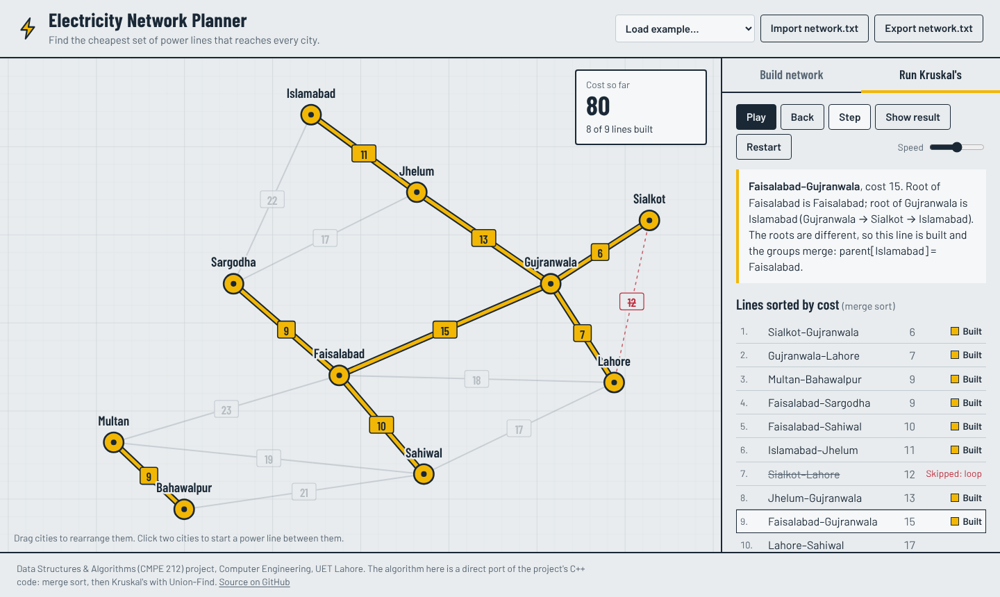

# Electricity Distribution Network using MST

Find the cheapest way to connect every city to the electricity grid. Cities are vertices, possible power lines are weighted edges, and **Kruskal's algorithm** picks the set of lines that reaches every city at the lowest total cost: a Minimum Spanning Tree.

Final term project for **Data Structures & Algorithms (CMPE 212)**, Department of Computer Engineering, UET Lahore (4th semester, project #18).

**Live demo:** https://syedatehreem488.github.io/electricity-network-mst/

<picture>
  <source media="(prefers-color-scheme: dark)" srcset="assets/screenshot-dark.png">
  
</picture>

## What's in this repo

| Part | What it is |
| --- | --- |
| [`src/main.cpp`](src/main.cpp) | The original C++ console program: menu-driven, with file save/load |
| [`docs/`](docs/) | Web GUI (HTML/CSS/JS), hosted on GitHub Pages |
| [`data/network.txt`](data/network.txt) | Sample network from the report, in the program's file format |
| [`tests/compare_with_cpp.js`](tests/compare_with_cpp.js) | Runs random networks through both versions and checks they pick the same MST |

## Features

**C++ console program**
- Add cities (duplicates rejected) and weighted connections (negative costs rejected)
- List all cities and connections
- Compute the MST with Kruskal's algorithm and show its total cost
- Save the network to `network.txt` and load it back

**Web GUI**
- Build a network by typing, or click two cities on the map to connect them
- Drag cities around the map
- Step through Kruskal's algorithm one edge at a time, or play it as an animation
- See the merge-sorted edge list, which lines get built or skipped, and why
- Watch the Union-Find `parent[]` array change at every step
- Import and export `network.txt` files that work with the C++ program
- Warns you when some cities can't be reached
- Works on phones, and supports dark mode

The algorithm in [`docs/js/kruskal.js`](docs/js/kruskal.js) is a line-by-line port of the C++ code: same merge sort, same Union-Find, same tie-breaking. CI checks that both give identical results on hundreds of random networks.

## Running the C++ program

```bash
g++ -std=c++17 -o mst src/main.cpp
./mst            # on Windows: mst.exe
```

```
Menu:
1. Add City
2. Display All Cities
3. Add Connection Between Cities
4. Display Connections
5. MST
6. Save Data
7. Load Data
8. Exit Program
```

To try the sample network, run the program from inside `data/` and choose **7. Load Data**, then **5. MST**.

## Running the web GUI

Open `docs/index.html` in a browser. There's nothing to install or build.

## How it works

### Data structures
- **`vector<string> cities`**: the vertices. A city's index is its numeric ID.
- **`vector<Edge> edges`**: the weighted, undirected edges (`city1`, `city2`, `cost`).
- **`vector<int> parent`**: the Union-Find (disjoint set) array used to detect cycles.

### Algorithm
1. **Merge sort** the edges by cost, cheapest first.
2. Put every city in its own set: `parent[i] = i`.
3. For each edge in sorted order, find the root of both cities.
   - Different roots: add the edge to the MST and merge the sets (`parent[rootB] = rootA`).
   - Same root: the cities are already connected, so this edge would form a cycle. Skip it.

### Complexity

| Operation | Time |
| --- | --- |
| Add city / add connection | O(V) |
| Display cities / connections | O(V) / O(E) |
| Merge sort of edges | O(E log E) |
| Find (no path compression) | O(V) worst case |
| Kruskal's MST | O(E log E + E·V) |
| Save / load | O(V + E) |

Space: O(V + E).

## Sample run

Cities: Lahore, Karachi, Islamabad, Peshawar
Connections: Lahore–Karachi (10), Lahore–Islamabad (6), Lahore–Peshawar (5), Karachi–Islamabad (15), Islamabad–Peshawar (4)

| Step | Edge | Cost | Result |
| --- | --- | --- | --- |
| 1 | Islamabad–Peshawar | 4 | Built |
| 2 | Lahore–Peshawar | 5 | Built |
| 3 | Lahore–Islamabad | 6 | Skipped: Lahore and Islamabad are already connected through Peshawar |
| 4 | Lahore–Karachi | 10 | Built: Karachi joins the network |
| 5 | Karachi–Islamabad | 15 | Skipped: would make a loop |

```
Islamabad---Peshawar having cost: 4
Lahore---Peshawar having cost: 5
Lahore---Karachi having cost: 10
Total MST cost: 19
```

4 cities, 3 power lines, total cost **19**.

## Possible improvements
- Path compression and union by rank would make Find almost O(1).
- Stop the loop early once V−1 edges have been picked.
- City names must be one word, because `cin >>` reads word by word. `getline` would allow spaces.
- Validate the menu input, so typing a letter instead of a number doesn't loop forever.

## Author
Syeda Tehreem Fatima (2024-CE-86), Computer Engineering, UET Lahore

Course instructor: Mr. Mujtaba Kamal Pasha

## License
[MIT](LICENSE)
